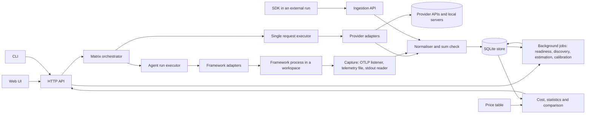

# Token Calculator: Technical Requirements

Version 0.2, 17 November 2026. Draft for review. Companion: [Product Requirements](PRD.md).

Token Calculator is a local Node.js service with a React UI. It runs a task through a provider adapter or a framework adapter, normalises every usage record into six token buckets, and stores the result in SQLite. Later releases add an ingestion API, staged execution, and estimation and calibration jobs on the same store.

Requirement codes (FR, NFR, AC, W, D, RK) are defined in the PRD.

## 1. Architecture

A matrix run takes one of two paths. Single request mode calls a provider API directly. Agent mode starts a framework process and captures the usage it reports. Both paths end in the same normaliser and store. From release 2 an ingestion API feeds the same normaliser. From release 3 background jobs read the store to produce estimates.



| Component | Responsibility |
| --- | --- |
| Matrix orchestrator | Expands a task and its configurations into runs, runs them one at a time, and records state |
| Single request executor | Builds one request, sends it through a provider adapter, and runs the acceptance checks |
| Agent run executor | Creates the workspace, starts capture, spawns the framework, enforces limits, and runs the acceptance checks |
| Provider adapters | One module per API style. Each sends a request and normalises the usage object. |
| Framework adapters | One module per framework. Each builds the command line, names its capture source, and parses usage. |
| Capture | Receives what the framework reports: OTLP log events, a telemetry file, or JSON lines on stdout |
| Normaliser and sum check | Maps raw usage to six buckets and checks them against the reported total |
| Store | SQLite file that holds tasks, configurations, baselines, runs and usage rows |
| Cost, statistics and comparison | Calculates cost at query time, baseline statistics and W1 to W6 |
| Ingestion API and SDK | Accept usage events for runs started outside the tool (release 2) |
| Readiness engine | Checks a feature contract against a versioned ruleset (release 3) |
| Discovery worker | Inspects a repo read-only within its own limits (release 3) |
| Estimation engine | Predicts work packages and simulates the feature (release 3) |
| Change detector and calibration | Classifies changes, revises forecasts and evaluates estimators (release 4) |

## 2. Stack and layout

| Area | Choice | Reason |
| --- | --- | --- |
| Language | TypeScript in strict mode on the current Node.js LTS | Typed adapter contracts |
| HTTP | Express | Already used by usage-collector |
| Store | SQLite, one file under `data/` | Per-call rows reach six figures, which the collector's JSON file store is not built for |
| UI | React built with Vite, served by the same process | Matches the existing dashboard |
| Tests | Vitest for unit, contract and integration tests. Playwright for the UI scenario. | One runner for all scenarios in section 15 |
| Network | Port 4610 by default, bound to 127.0.0.1, no authentication | Same model as the collector on port 4600 |
| Background jobs | An in-process queue persisted in SQLite | One user on one machine does not need a separate queue service (D10) |

```text
files/token-calculator/
  docs/                     PRD.md, TRD.md
  src/core/                 buckets, normalisers, pricing, statistics, hashing
  src/adapters/providers/   one module per API style
  src/adapters/frameworks/  one module per framework
  src/capture/              OTLP listener, file reader, stdout reader
  src/runner/               orchestrator, executors, limits, workspaces
  src/store/                SQLite schema and queries
  src/server/               HTTP API
  src/cli/                  tokcalc command
  src/ingest/               ingestion API (release 2)
  src/sdk/                  TypeScript SDK (release 2)
  src/profiles/             execution profiles, stages, repair, context (release 2)
  src/estimate/             readiness, discovery, work packages, simulation (release 3)
  src/calibrate/            change detection, revisions, calibration (release 4)
  web/                      React UI
  fixtures/                 recorded usage payloads with expected buckets
  test/                     one test file per scenario ID
```

## 3. Coexistence with usage-collector

Token Calculator and the collector run side by side and share no data path.

1. **Separate store.** Token Calculator never writes `usage-log.json` and never calls `/api/ingest` (FR-27).
2. **One-door rule.** The collector allows one intake per source. Token Calculator's capture listener is private to a run, and framework telemetry is never pointed at the collector.
3. **No edits to user config.** Adapters configure a framework only through the arguments and environment of the child process. User-level settings files are not changed, so the collector's watchers keep working as configured.
4. **Agent runs still appear in the collector.** Its watchers read the same session logs, so benchmark spend is recorded there as normal usage. The `tokcalc-` workspace prefix identifies those records by project.
5. **Single request runs do not appear in the collector.** Sending them would need a new source in the collector's registry, which is outside release 1.
6. **Ingestion is not a second door into the collector.** From release 2 an external run can report to Token Calculator through the SDK (FR-44). The same tool can still be watched by the collector, because the stores are separate and the one-door rule applies inside each store.

To compare figures by hand, the collector's four-part breakdown maps to the buckets as follows: input is `uncached_input` plus `tool_input`, output is `visible_output` plus `reasoning`, and cache read and cache write are unchanged.

## 4. Data model

| Table | Key columns |
| --- | --- |
| `providers` | `id`, `api_style`, `base_url`, `api_key_env` |
| `prices` | `provider_id`, `model`, `bucket`, `micro_usd_per_mtok`, `tier_min_input_tokens`, `effective_from`, `source`, `read_on` |
| `tasks` | `id`, `name`, `kind` (`prompt` or `repo`), `definition_json`, `contract_version_id`, `limits_json`, `store_content`, `hash` |
| `configurations` | `id`, `mode`, `framework_id`, `framework_version`, `provider_id`, `model`, `params_json`, `profile_json`, `version`, `hash` (unique) |
| `matrices` | `id`, `task_id`, `runs_per_configuration`, `max_spend`, `status` |
| `baselines` | `id`, `matrix_id`, `task_id`, `task_hash`, `configuration_id`, `status` |
| `runs` | `id`, `baseline_id`, `seq`, `status`, `reason`, `started_at`, `ended_at`, `granularity`, `warm_start`, `unparsed_lines`, `reported_total_json`, `workspace`, `pid` |
| `usage_rows` | `id`, `run_id`, `event_id` (unique), `revision`, `parent_id`, `seq`, `ts`, `model`, `source`, `stage`, `request_status`, six bucket columns, `provider_total`, `check_status`, `normaliser_version`, `completeness`, `estimated`, `tokenizer`, `duration_ms`, `tool_result_size`, `raw_json` |
| `run_content` | `run_id`, `prompt_text`, `response_text`. Written only when `store_content` is on. |
| `contract_versions` | `id`, `feature_id`, `version`, `prd_ref`, `prd_digest`, `trd_ref`, `trd_digest`, `exclusions_json`, `contracts_json`, `hash` |
| `acceptance_criteria` | `contract_version_id`, `key`, `mandatory`, `evidence_required`, `check_cmd` |
| `open_decisions` | `contract_version_id`, `description`, `owner`, `affected`, `resolution`, `scenarios_json` |
| `criterion_results` | `run_id`, `criterion_key`, `result`, `evidence_ref`, `manual`, `evaluator` |
| `charges` | `usage_row_id`, `kind`, `amount`, `source` |
| `cost_calculations` | `id`, `baseline_id`, `usage_revision`, `price_snapshot_json`, `calculation_version`, `created_at` |
| `adaptation_events` | `run_id`, `trigger`, `change_json`, `ts` |
| `repair_cycles` | `run_id`, `seq`, `failed_criteria`, `repair_rows`, `result` |
| `context_manifests` | `usage_row_id`, `sources_json`, `sizes_json`, `policy_version`, `truncations_json`, `cache_json`, `availability` |
| `readiness_assessments` | `contract_version_id`, `ruleset_version`, `status`, `findings_json` |
| `discovery_jobs` | `id`, `contract_version_id`, `repo_commit`, `limits_json`, `status`, `inspected_paths_json`, `findings_json`, `usage_json` |
| `estimates` | `id`, `type`, `fingerprint`, `evidence_level`, `assumptions_json`, `distribution_json`, `revision_of`, `reason` |
| `work_packages` | `estimate_id`, `key`, `requirement_refs`, `validation_refs`, `depends_on`, `uncertainty` |
| `change_events` | `id`, `input`, `classification`, `affected_estimates` |
| `estimator_versions` | `id`, `method`, `training_ref`, `validation_report_json`, `status` |
| `jobs` | `id`, `kind`, `status`, `progress`, `cancel_requested` |

Rules:

- Bucket columns are nullable integers. NULL means not reported (FR-16).
- Run status is one of `queued`, `running`, `passed`, `failed`, `unchecked`, `cancelled`, `limit`, `escalated` or `error`.
- Cost is calculated from `usage_rows`, `charges` and `prices`. Each calculation for a completed baseline is stored in `cost_calculations`, and repricing adds a new one (FR-35).
- Price rows are only inserted. A new price is a new row with a later `effective_from`.
- A completed baseline is read-only (FR-21).
- Contract versions, profile versions and estimates are immutable. A correction is a new version.
- Tables from `adaptation_events` onward belong to releases 2 to 4.

## 5. Token normalisation

Every usage record becomes six buckets that do not overlap: `uncached_input`, `cache_read`, `cache_write`, `visible_output`, `reasoning` and `tool_input`.

| Bucket | `anthropic-messages` | `openai-responses` | `openai-chat` | `gemini-generate-content` |
| --- | --- | --- | --- | --- |
| `uncached_input` | `input_tokens` | `input_tokens` − `cached_tokens` − `cache_write_tokens` | `prompt_tokens` − `cached_tokens` − `cache_write_tokens` | `promptTokenCount` − `cachedContentTokenCount` |
| `cache_read` | `cache_read_input_tokens` | `input_tokens_details.cached_tokens` | `prompt_tokens_details.cached_tokens` | `cachedContentTokenCount` |
| `cache_write` | `cache_creation_input_tokens` | `input_tokens_details.cache_write_tokens` | `prompt_tokens_details.cache_write_tokens` | not reported |
| `visible_output` | `output_tokens` − `thinking_tokens` | `output_tokens` − `reasoning_tokens` | `completion_tokens` − `reasoning_tokens` | `candidatesTokenCount` |
| `reasoning` | `output_tokens_details.thinking_tokens` | `output_tokens_details.reasoning_tokens` | `completion_tokens_details.reasoning_tokens` | `thoughtsTokenCount` |
| `tool_input` | not reported | not reported | not reported | `toolUsePromptTokenCount` |
| Reported total | none | `total_tokens` | `total_tokens` | `totalTokenCount` |

Rules:

1. **Not reported is not zero.** A field that is absent gives NULL. A field that is present with value 0 gives 0. A subtraction treats an absent detail field as 0 and leaves the detail bucket NULL.
2. **Sum check.** Where the source gives a total, the non-null buckets must add up to it. The result is stored as `check_status`: `ok`, `mismatch` or `unchecked`. Values are never adjusted to fit (NFR-1).
3. **Negative results.** A subtraction that goes below zero stores NULL for that bucket and sets `mismatch`.
4. **Pure functions.** Each normaliser takes a raw usage object and returns buckets, with no I/O. Each has at least one recorded fixture with hand-calculated expected values.
5. **Duplicates.** Every event has an ID. For captured usage it is the source's own request or event ID, or a hash of the raw record when there is none. A repeated ID is ignored (FR-28).
6. **Snapshots and revisions.** A cumulative snapshot replaces the previous snapshot for that session. A corrected event is stored with the next `revision` number, and totals use the latest revision (FR-30).
7. **Version and completeness.** Each row stores `normaliser_version` and `completeness`. `complete` means every bucket the source can report is present. `partial` means some are missing. `unknown` means the source reported no usage (FR-29).
8. **Estimates.** A row counted with a local tokenizer sets `estimated` and names the tokenizer and its version. Estimated rows are always shown apart from measured rows (FR-31).
9. **Failed requests.** A failed request that reports usage is stored with `request_status` `failed` and counted (FR-32).

Basis for the mapping:

- **Anthropic.** Total input is the sum of `input_tokens`, `cache_creation_input_tokens` and `cache_read_input_tokens`, so the three are already separate. `thinking_tokens` reports how many of the billed output tokens were reasoning, so it is subtracted from `output_tokens`.
- **OpenAI Responses.** In OpenAI's prompt caching example, `cached_tokens` and `cache_write_tokens` add up to `input_tokens`, so both are parts of it. Treating `reasoning_tokens` as part of `output_tokens` is an assumption. The sum check against `total_tokens` fails if it is wrong.
- **OpenAI-compatible chat.** Field names follow the Chat Completions usage object. Compatible servers vary, and local servers often return only `prompt_tokens` and `completion_tokens`, so every detail field is optional.
- **Gemini.** `totalTokenCount` is the sum of the prompt, candidates, tool-use prompt and thoughts counts. `cachedContentTokenCount` is part of `promptTokenCount`.

## 6. Provider adapters

A provider adapter handles one API style. A provider entry is data, so adding a provider that uses a supported style needs no code (FR-1, NFR-9).

```ts
type Bucket =
  | 'uncached_input' | 'cache_read' | 'cache_write'
  | 'visible_output' | 'reasoning' | 'tool_input';

type Buckets = Record<Bucket, number | null>; // null = not reported

interface ProviderConfig {
  id: string;
  apiStyle: 'anthropic-messages' | 'openai-responses' | 'openai-chat' | 'gemini-generate-content';
  baseUrl: string;
  apiKeyEnv: string | null; // null for local servers
}

interface ProviderAdapter {
  apiStyle: ProviderConfig['apiStyle'];
  buildRequest(task: PromptTask, model: string, params: unknown): HttpRequest;
  send(req: HttpRequest, provider: ProviderConfig): Promise<{ text: string; rawUsage: unknown }>;
  normalise(rawUsage: unknown): { buckets: Buckets; providerTotal: number | null };
}
```

```yaml
providers:
  - id: anthropic
    api_style: anthropic-messages
    base_url: https://api.anthropic.com
    api_key_env: ANTHROPIC_API_KEY
  - id: local-mlx
    api_style: openai-chat
    base_url: http://127.0.0.1:8080/v1
    api_key_env: null
```

Rules:

- Requests are sent without streaming in release 1, so usage arrives in one response body.
- The key is read from the environment when the request is sent. It is never written to disk (NFR-3).
- HTTP 429 and 5xx responses are retried up to 2 times with backoff. Each attempt is logged. An attempt that reports usage is stored and counted, even when it failed (FR-32).
- Model IDs and parameters pass through unchanged (FR-3, FR-5).
- Reasoning content is not requested where the API makes it optional, and it is never stored (NFR-13).

## 7. Framework adapters

A framework adapter knows how to start one framework headlessly and how to read the usage it reports.

```ts
interface UsageRow {
  seq: number;
  ts: string;
  model: string;
  source: 'main' | 'subagent' | 'auxiliary' | null;
  buckets: Buckets;
  providerTotal: number | null;
  durationMs: number | null;
  toolResultSize: number | null;
  raw: unknown;
}

type CaptureSpec =
  | { kind: 'otlp-logs'; eventNames: string[] }
  | { kind: 'file'; path: string }
  | { kind: 'stdout-jsonl' };

interface FrameworkAdapter {
  id: string;
  detect(): Promise<{ installed: boolean; version: string | null }>;
  capabilities: {
    granularity: 'call' | 'turn' | 'session';
    reportsReasoning: boolean;
    reportsSource: boolean;
    reportsToolResultSize: boolean;
    nativeBudgetCap: boolean;
    reportsStages: boolean;
    reportsContext: boolean;
  };
  supports(provider: ProviderConfig): boolean;
  plan(run: AgentRunSpec): { argv: string[]; env: Record<string, string>; capture: CaptureSpec };
  parse(captured: CapturedOutput): { rows: UsageRow[]; unparsedLines: number };
  reportedTotal(captured: CapturedOutput): Partial<Buckets> | null;
}
```

**Release 1 adapters**

| Framework | Headless launch | Capture source | Granularity | Fields |
| --- | --- | --- | --- | --- |
| Claude Code | `claude -p` with `--output-format json` | OTLP log event `claude_code.api_request` | call | `input_tokens`, `output_tokens`, `cache_read_tokens`, `cache_creation_tokens`, `query_source`, `cost_usd`, `duration_ms` |
| Gemini CLI | `gemini -p` with `--output-format json` | Telemetry file, event `gemini_cli.api_response` | call | `input_token_count`, `output_token_count`, `cached_content_token_count`, `thoughts_token_count`, `tool_token_count` |
| Codex CLI | `codex exec --json` | stdout JSON lines, event `turn.completed` | turn | `input_tokens`, `cached_input_tokens`, `output_tokens` |
| Pi | `pi --mode json` | stdout JSON lines | to confirm | usage on assistant messages |

How far each row is verified:

- **Claude Code and Gemini CLI.** Read from the official docs listed in section 17. In Claude Code's event, `input_tokens` excludes cache tokens, and the event has no thinking field, so `reasoning` is not reported for Claude Code runs. Its tool result event reports `tool_result_size_bytes`, which feeds W4.
- **Codex CLI.** Taken from search results of the official Codex docs. The page itself could not be opened, so the adapter's first test must confirm the event and field names against the installed version.
- **Pi.** Launch flags come from the package docs. Its JSON mode page lists event types but not usage fields, so the first test must record a session and confirm them.
- **All four.** Whether an input count includes cached tokens must be settled from a recorded session before the normaliser is written.

Capture settings passed in the child environment:

```text
# Claude Code
CLAUDE_CODE_ENABLE_TELEMETRY=1
OTEL_LOGS_EXPORTER=otlp
OTEL_EXPORTER_OTLP_LOGS_PROTOCOL=http/protobuf
OTEL_EXPORTER_OTLP_LOGS_ENDPOINT=http://127.0.0.1:<run port>
OTEL_LOGS_EXPORT_INTERVAL=1000

# Gemini CLI
GEMINI_TELEMETRY_ENABLED=true
GEMINI_TELEMETRY_OUTFILE=<run directory>/telemetry.log
```

Rules:

- Every run starts a new session. Nothing is resumed.
- Options that change what the framework loads are configuration parameters, so they are part of the hash. Claude Code's `--bare` is one. It skips hooks, skills, plugins, MCP servers, auto memory and `CLAUDE.md`. It does not use a subscription login, so the run needs an API key. It is on by default so that baselines are the same on every machine.
- Runs are unattended. Each adapter sets the framework's own permission flags from configuration, such as `--permission-mode` and `--allowedTools` for Claude Code.
- Where the framework has its own budget cap, such as `--max-budget-usd` in Claude Code, the adapter sets it in addition to the runner's limit.
- `reportedTotal` reads the framework's own end-of-run figures. The runner stores them for the cross-check in AC-3.
- No release 1 framework reports stages or context sources, so both flags are false. Stage attribution comes from the staged workflow in section 11.

## 8. Run lifecycle

**Agent run**

1. Create the workspace `data/workspaces/tokcalc-<task>-<run id>` as a local clone of the task repo at the pinned commit, with the remote removed.
2. Start the capture the adapter asks for: an OTLP listener on a free 127.0.0.1 port, a telemetry file in the run directory outside the workspace, or a stdout reader.
3. Spawn the framework in its own process group, with the adapter's arguments and environment and the workspace as working directory. Record the process ID.
4. Check the cost, token, duration and call limits as usage rows arrive and on a timer. On a breach send SIGINT, then SIGKILL after 10 seconds.
5. After the process exits, let capture drain for up to 10 seconds, then stop it.
6. Run the check for each acceptance criterion in the workspace with its own timeout, and record a result per criterion (FR-34).
7. Normalise, run the sum check, and store the run, its rows and the framework's reported total.
8. Delete the workspace unless the task keeps it.

**Single request run**

1. Build the request from the task and the configuration.
2. Send it and read usage from the response body.
3. Run the checks for the acceptance criteria with the response text on standard input.
4. Normalise, run the sum check and store.

**Order, limits and recovery**

- Runs execute one at a time, in rotation across configurations, so that drift over time affects every configuration equally.
- The cost limit uses the price table. It cannot apply to an unpriced model, so the duration and call limits are mandatory.
- Run state is written before and after each step. On start-up, a run still marked `running` becomes `error` with reason `interrupted`, its recorded process group is killed, and the matrix can resume at the next queued run (NFR-6).
- A run that ends with no usage rows becomes `error` with reason `no_usage_captured` (NFR-11).
- A cancel request stops the current run with status `cancelled` and leaves queued runs unstarted (FR-13).

**Security**

- Error text is scrubbed of key values before it is logged or stored (NFR-3).
- When content storage is on, text passes through a secret redactor before it is written. Reasoning text is never written (NFR-13, NFR-14).
- The server and every listener bind to 127.0.0.1 (NFR-4).
- Agent frameworks run commands. Use a container or virtual machine for repos that are not trusted (RK3).

## 9. Cost, statistics and metrics

**Cost**

- The total input of a row is `uncached_input` + `cache_read` + `cache_write` + `tool_input`, with NULL counted as 0.
- A rate is an integer in micro-dollars per million tokens. Row cost is the sum over buckets of tokens × rate, held as a 64-bit integer in units of 10⁻¹² dollars. Dollars are derived only for display (NFR-2).
- The rate used is the latest price row for that provider, model and bucket with `effective_from` on or before the run start, in the highest tier whose `tier_min_input_tokens` is at or below the row's total input.
- A missing rate falls back: `reasoning` to `visible_output`, and `tool_input`, `cache_read` and `cache_write` to `uncached_input`. A model with no `uncached_input` or `visible_output` rate is `unpriced`.
- Not priced separately in release 1: cache-write lifetime variants, batch pricing and priority tiers. They use the standard rate.
- A charge that is not per token is a row in `charges`, in the same integer unit. Run cost is token cost plus charges (FR-36).
- Each calculation for a completed baseline is stored with its usage revision, price rows and calculation version. Repricing adds a calculation and keeps the old one (FR-35).

**Baseline statistics**

Statistics use every run in the baseline that has usage rows.

| Statistic | Definition |
| --- | --- |
| Median, minimum, maximum | Per bucket and for cost, across runs |
| Spread | (maximum − minimum) ÷ median, for cost |
| Pass rate | Passed runs ÷ runs. NULL when the task has no acceptance check. |
| Cost per passing run | Total cost of all runs ÷ passed runs. NULL when no run passed. |
| Range overlap | Two baselines overlap when one's minimum cost is at or below the other's maximum, and the reverse |
| Run duration | Median, minimum and maximum wall-clock time per run |
| Sample size | The number of runs behind each statistic, shown beside it |
| Cold and warm cost | The cost statistics again, split by `warm_start` |

**Framework metrics**

| Code | Formula | Needs |
| --- | --- | --- |
| W1 | Total input of the first row whose source is main | Call granularity |
| W2 | Least-squares slope of total input against call index, in tokens per call | Call granularity |
| W3 | Sum of `cache_read` ÷ sum of total input | Any granularity |
| W4 | Sum of `tool_result_size`, in the unit the framework reports | Adapter reports tool result size |
| W5 | Tokens in rows whose source is subagent ÷ all tokens | Adapter reports source |
| W6 | API calls across all runs ÷ passed runs | Call granularity |

A metric whose need is not met is NULL. A run is flagged `warm_start` when its first row has `cache_read` above 0 (RK5).

**Comparability warnings**

A comparison is still shown, with a warning, when the baselines differ in any of these: number of runs, limits, price dates, presence of warm-start runs, presence of `partial` or `unknown` usage, or presence of `estimated` rows (FR-22).

**Value labels**

Every reported value carries one label. A measured value comes straight from a source. A derived value comes from arithmetic on measured values, such as `uncached_input` by subtraction, or a median. A predicted value comes from an estimate (FR-37).

## 10. Ingestion and SDK

Release 2. A run started outside the tool reports through the ingestion API. Its events pass through the same normaliser and land in the same tables as captured usage.

```text
POST /api/ingest/runs                 register a run against a contract version and a profile
POST /api/ingest/runs/:id/events      send a batch of usage events
POST /api/ingest/runs/:id/complete    close the run and reconcile
```

Rules:

- Each event carries a globally unique `event_id`, a `parent_id` or null, a timestamp, a status, the raw usage and an optional stage.
- Ingestion is idempotent on `event_id`. A repeated event returns success and changes nothing (FR-28, FR-44).
- Events are accepted in any order. Order inside a run comes from timestamps and parent links (FR-45).
- Completing a run marks every request that started but has no terminal event as `unknown`, which lowers the run's completeness (FR-44).
- A batch is acknowledged once it is written, within the target in NFR-18.
- Default telemetry carries no credentials and no prompt or response text (NFR-3, NFR-5).

The SDK keeps a bounded in-memory queue, retries with backoff and never throws into the host. When the queue is full it drops the oldest events, counts them, and reports the count on the next successful send (NFR-16).

## 11. Execution profiles, stages and context

Release 2. An execution profile is a configuration with extra fields. The hash covers every field, and a stored profile version cannot be edited (FR-38).

```yaml
profile:
  stages: [discovery, planning, implementation, validation, repair, review]
  tools: [read, edit, bash]
  context_policy:
    stage_token_allowance: { discovery: 60000, implementation: 120000 }
    history: keep_last_20_turns
    summarise_above_tokens: 80000
    max_tool_output_tokens: 8000
    prefix_order: [instructions, contract, repo_map]
  budgets:
    run: { max_cost_usd: 5, max_tokens: 2000000 }
    stage: { discovery: { max_tokens: 200000 } }
  repair: { max_cycles: 2, escalate_on: [same_failure_twice] }
  stopping: [accepted, limit, repair_limit, cancelled]
  adaptations_allowed: [switch_model_on_repair]
```

**Stages**

- A staged run is driven by the runner. It starts the framework once per stage in the same workspace, with a stage prompt built from the feature contract.
- Every usage row captured during a stage invocation takes that stage. Usage outside a stage, and all usage from an unstaged run, is `unattributed` (FR-40).
- Stage totals plus unattributed must equal the run total. The store checks this when the run ends.
- Stage budgets are limits. They stop a stage after a breach, in the same way as run limits. Nothing is reserved in advance (N4).

**Repair and escalation**

- After validation, each failed mandatory criterion opens a repair cycle. The cycle records the failed criteria, the usage rows of the repair attempt and the next validation result.
- When `max_cycles` is reached, or an escalation condition holds, the run ends as `escalated`. Comparisons show repair cycles per run (FR-41).
- A permitted adaptation writes an `adaptation_events` row with its trigger and the change. An adaptation the profile does not allow is refused (FR-39).

**Context**

- Where the runner or the SDK assembles the context, each request stores a manifest: source references, token sizes, policy version, truncation and summarisation events, and cache observations (FR-42).
- Where a third-party framework assembles the context, the manifest's `availability` is `unavailable`.
- A manifest holds references and sizes. Content is stored only when the task turns storage on.
- A summarisation call is an ordinary usage row, so its tokens are counted (FR-43).

## 12. Readiness and estimation

Release 3. Estimates are produced by background jobs that read measured runs from the store.

**Readiness checks**

1. Every mandatory criterion maps to a validation task.
2. Every work package references a requirement.
3. Dependencies form a graph with no loops.
4. Required technical contracts and repo references exist.
5. Every open decision is resolved or has explicit scenarios.
6. The selected execution profile is supported.
7. Pricing and telemetry capabilities for the profile are known.

The result is `ready`, `ready_with_scenarios` or `not_ready`, with findings and the ruleset version (FR-47). A readiness result checks structure. It does not confirm that the requirements are correct.

**Estimate types**

| Type | Inputs | Needs |
| --- | --- | --- |
| `preliminary` | Documents and repository metadata | Nothing. Missing evidence is listed (FR-48). |
| `planning` | Discovery evidence, readiness result, task graph, profile | Readiness of `ready` or `ready_with_scenarios` (FR-50) |
| `revision` | Measured usage to date and remaining work | An earlier estimate (FR-55) |

**Discovery**

- A discovery job reads the repo at a pinned commit. It never executes repository code and never writes to the repo (NFR-15).
- It has its own limits, reports progress, and can be cancelled. Its end states are `completed`, `budget_exhausted`, `cancelled` and `failed` (FR-49).
- It records inspected paths, existing patterns, test infrastructure, dependency findings, open questions and its own usage.

**Fingerprint**

Every estimate stores a hash of its inputs: contract version, repo commit, profile version, task graph version, discovery evidence, estimator version and price rows (FR-50).

**Work packages and simulation**

- Each work package predicts initial implementation, validation, repair probability and usage, escalation probability, and rework caused by dependencies (FR-51).
- The feature is simulated as many trajectories that keep dependencies and correlated failures. Each trajectory gives usage by bucket and stage, cost, elapsed time where supported, an acceptance outcome and a termination reason.
- Shared work is counted once. A total percentile comes from simulated totals, never from adding percentiles of separate buckets.

**Forecast outputs**

- The distribution of consumption before a run stops.
- The probability of acceptance within a budget.
- The budget needed for a target probability, or `target not supported` when the workflow cannot reach the target (FR-52).
- The probability of escalation or of reaching a limit.

A run stopped by a limit is evidence about that limit. It does not show what completion without the limit would have cost.

**Evidence levels**

| Level | Basis |
| --- | --- |
| `provisional` | Explicit scenarios and assumptions |
| `historical` | Comparable measured features in the store |
| `calibrated` | Predictions validated on held-out features |

The reasoning split, cache forecast and completion probability are left out when the evidence level cannot support them. Usage from discovery and estimation jobs is tagged as estimation overhead and reported apart from implementation cost (FR-53).

**Jobs**

Discovery and estimation run in the in-process queue. The API returns a job ID at once. A cancel request sets `cancel_requested`, and the job checks it between steps (NFR-19).

## 13. Change detection and calibration

Release 4.

**Change detection**

| Change | Default classification |
| --- | --- |
| Contract text changed, with the same criteria, exclusions and technical contracts | `informational` |
| Acceptance criteria, exclusions or technical contracts changed | `forecast_invalidating` |
| Repo commit changed | `review_required` |
| Execution profile, context policy or stopping rules changed | `forecast_invalidating` |
| Measured usage of a work package is above its predicted range | `review_required` |

The rules are configurable. An invalidated estimate is marked and stays visible (FR-54).

**Revisions**

A revision equals measured usage to date plus predicted remaining usage. It is a new `estimates` row that names the estimate it revises, the reason, the changed assumptions and the remaining task state. The original is never overwritten (FR-55).

**Calibration**

- Whole features are held out, so runs and tasks of one feature never sit on both sides.
- The report gives absolute and weighted error, interval coverage and width, and completion-probability calibration, by feature category, configuration and time. It states the validation period and sample size (FR-56).
- A new estimator version is promoted only when it beats the current one on held-out features.
- A configuration with too few measured features falls back to a lower evidence level.
- After a model or framework version changes, new runs are compared with the earlier distribution, and shifts in usage, outcomes or context behaviour are flagged.

**Self-monitoring**

`GET /api/status` returns counters for dropped events, unparsed lines, normalisation mismatches, missing prices, failed discovery jobs and invalidated estimates (NFR-17).

## 14. API and CLI

All endpoints are JSON over HTTP on 127.0.0.1.

| Method | Path | Purpose |
| --- | --- | --- |
| GET | `/health` | Liveness |
| GET | `/api/providers` | List providers |
| POST | `/api/providers` | Add a provider |
| GET | `/api/prices` | List price rows |
| POST | `/api/prices` | Add price rows |
| GET | `/api/tasks` | List tasks |
| POST | `/api/tasks` | Add a task or a new version of one |
| GET | `/api/frameworks` | Adapters, whether each is installed, its version and capabilities |
| POST | `/api/matrices` | Create a matrix. Returns its baselines and maximum spend. |
| GET | `/api/matrices/:id` | Progress and run statuses |
| POST | `/api/matrices/:id/start` | Start |
| POST | `/api/matrices/:id/resume` | Resume after an interruption |
| POST | `/api/matrices/:id/cancel` | Stop the current run and cancel the rest |
| GET | `/api/baselines` | List baselines, filtered by task |
| GET | `/api/baselines/:id` | Statistics and runs |
| GET | `/api/runs/:id` | Usage rows in order |
| GET | `/api/compare` | Compare the baselines named in the query |
| GET | `/api/export` | CSV or JSON export |
| POST | `/api/contracts` | Add a feature contract version |
| GET | `/api/contracts/:id` | Read a contract version |
| POST | `/api/runs/:id/criterion-results` | Record a manual attestation |
| POST | `/api/ingest/runs` | Register an external run |
| POST | `/api/ingest/runs/:id/events` | Send a batch of events |
| POST | `/api/ingest/runs/:id/complete` | Close a run and reconcile |
| POST | `/api/profiles` | Add a profile version |
| POST | `/api/readiness` | Assess a contract version |
| POST | `/api/discovery-jobs` | Start a discovery job |
| POST | `/api/estimates` | Create a preliminary or planning estimate |
| POST | `/api/estimates/:id/revisions` | Revise a forecast |
| GET | `/api/estimates/:id` | Read an estimate with its evidence |
| GET | `/api/jobs/:id` | Job progress |
| POST | `/api/jobs/:id/cancel` | Cancel a job |
| GET | `/api/calibration` | Latest calibration report |
| GET | `/api/status` | Self-monitoring counters |

Validation errors return 422. An edit to a completed baseline, a contract version or a profile version returns 409.

```text
tokcalc run <matrix.yaml>       create and start a matrix, exit 0 when it completes
tokcalc compare <baseline ids>  print a comparison
tokcalc export --format csv     write an export to stdout
```

```yaml
# matrix.yaml
task: checkout-coupon-field
runs: 3
limits: { max_cost_usd: 5, max_minutes: 30, max_calls: 200 }
configurations:
  - mode: single_request
    provider: anthropic
    model: <model id>
    params: { max_output_tokens: 4000 }
  - mode: agent
    framework: claude-code
    provider: anthropic
    model: <model id>
    params: { bare: true }
  - mode: agent
    framework: pi
    provider: local-mlx
    model: <model id>
```

## 15. TDD scenarios

Every FR and NFR has at least one scenario below. Each scenario is written as a failing test before the code that makes it pass.

**Method**

1. A test is named by its scenario ID, for example `T-16 not reported is not zero`.
2. Write the test, run it, and confirm it fails for the stated reason. Write the least code that passes. Then refactor.
3. A requirement is done when all of its scenarios pass.
4. A traceability test reads the PRD and this section and fails if any FR or NFR has no scenario (AC-1).
5. AC-2 to AC-9 use real providers or real measured data, so they are scripted but run by hand.

**Test doubles**

| Double | What it does |
| --- | --- |
| Fake provider server | Replays recorded responses for the four API styles. Can return errors and echo request headers. |
| Stub framework | A script that plays a scenario file. It emits usage through any capture source, reports a version, sleeps, writes files and exits with a set code. |
| Fake collector | An HTTP listener on port 4600 that records any request it receives |
| Fixtures | Recorded raw usage payloads, each with expected buckets calculated by hand |

**Levels:** U is unit. C is contract, against a recorded fixture. I is integration, using the test doubles. P is performance. E is end to end through the UI.

**Functional scenarios**

| ID | Covers | Level | Given | When | Then |
| --- | --- | --- | --- | --- | --- |
| T-01 | FR-1 | I | A config entry adds provider `acme` with style `openai-chat`, a base URL on the fake provider server and key variable `ACME_KEY` | A single request run starts for that provider | The fake server receives one request that carries the value of `ACME_KEY`. One run with one usage row is stored. No source file changed. |
| T-02 | FR-2 | C | One recorded response per API style, each with expected buckets | Each provider adapter normalises its fixture | All four results equal the expected buckets exactly |
| T-03 | FR-3 | I | Model ID `not-in-any-list-123` | A configuration is created and run against the fake server | The request carries the ID unchanged and the run stores it. Nothing rejects it. |
| T-04 | FR-4 | I | A provider with no key variable, and a fake local server that returns only `prompt_tokens` and `completion_tokens` | A single request run starts | No authorization header is sent. `uncached_input` and `visible_output` are set and the other four buckets are NULL. |
| T-05 | FR-5 | I | Parameters with a reasoning setting and an output limit | The request is built for each API style | The parameters appear in the request body and are stored on the configuration. Changing one changes the configuration hash. |
| T-06 | FR-6 | I | A task with a system prompt, a user prompt and two context files | A single request run starts | Exactly one request is sent, it contains all four parts, and one usage row is stored |
| T-07 | FR-7 | I | A stub framework scripted to emit 5 usage events, and a task with a repo at a pinned commit | An agent run starts | The stub runs in a new workspace at that commit, and 5 usage rows are stored with `seq` 1 to 5 |
| T-08 | FR-8 | I | Two of the four framework binaries on `PATH` | The framework list is requested, then a matrix names a missing framework | The list marks two as installed with their versions. The matrix is rejected with 422. |
| T-09 | FR-9 | I | A test adapter added under the adapters directory | A matrix selects it | The run completes and appears in the comparison |
| T-10 | FR-10 | I | A stub framework that reports version 9.9.9 | A run completes | The run holds version 9.9.9, the model ID and the parameters |
| T-11 | FR-11 | I | One task | A matrix runs 3 configurations, then the task is edited | All 3 baselines hold the same task hash. The edit gives a new hash and leaves those baselines unchanged. |
| T-12 | FR-12 | I | Limits of $0.10, 5,000 tokens, 1 minute and 3 calls, and a stub that breaks each one in turn | Four runs start | Each run is stopped within 10 seconds of the breach, with status `limit` and reason `max_cost`, `max_tokens`, `max_duration` or `max_calls` |
| T-13 | FR-13 | I | A task whose mandatory check exits 0, one whose check exits 1, one with no criteria, and a run that the user cancels | Each runs once | The statuses are `passed`, `failed`, `unchecked` and `cancelled`. Queued runs behind the cancelled one do not start. |
| T-14 | FR-14 | U | Every fixture in `fixtures/` | Each is normalised | Every bucket is NULL or a whole number of at least 0. Non-null buckets sum to the reported total where one exists. |
| T-15 | FR-15 | I | A fake response with a known usage object | The run is stored and read back | `raw_json` equals the usage object, and normalising it again gives the stored buckets |
| T-16 | FR-16 | U | An Anthropic usage object with no `output_tokens_details`, one with `output_tokens` 348 and `thinking_tokens` 312, and an OpenAI object with `reasoning_tokens` 0 | Each is normalised | `reasoning` is NULL in the first, 312 with `visible_output` 36 in the second, and 0 in the third |
| T-17 | FR-17 | U | Price versions effective 1 January and 1 June, a tier that starts at 200,000 input tokens, and a model with no price | Cost is calculated for runs dated 1 March and 1 July, for a 250,000-token call, and for the unpriced model | The March run uses the first version and the July run the second. The large call uses the tier rate. The unpriced model returns no cost and the label `unpriced`. Token rows are unchanged throughout. |
| T-18 | FR-18 | U | A synthetic run of 4 calls with known buckets, one of them a subagent call, then the same data at turn granularity | W1 to W6 are calculated | Call-level values equal the hand-calculated figures. At turn granularity W1, W2 and W6 are NULL. A run whose first call has cache reads is flagged `warm_start`. |
| T-19 | FR-19 | I | A matrix of 2 configurations with 3 runs each and a run cost limit of $1 | The matrix is created, then started | It reports a maximum spend of $6 before it starts. It produces 2 baselines of 3 runs, each run in its own workspace. |
| T-20 | FR-20 | U | Runs that cost $1, $2 and $6 with statuses passed, failed and passed. Then three failed runs. | Statistics are calculated | Median 2, minimum 1, maximum 6, spread 2.5, pass rate 0.667 and cost per passing run 4.5. With no passes, cost per passing run is NULL. |
| T-21 | FR-21 | U | Two identical configurations, then one field changed at a time | Hashes are calculated, and a completed baseline is edited | Identical inputs give one hash. Each change gives a new hash. The edit is rejected with 409. |
| T-22 | FR-22 | I | Two baselines of one task with overlapping cost ranges, one of them holding a warm-start run, and one baseline of another task | A comparison is requested for the first two, then for all three | The first returns both baselines with buckets, cost, run duration, pass rate, cost per passing run and W1 to W6, each with its run count. It flags the overlap and warns about the warm start. The second is rejected with 422. |
| T-23 | FR-23 | I | A stored run of 5 calls | The run is requested | Calls return in `seq` order with buckets and check status |
| T-24 | FR-24 | I | A store with 2 baselines | CSV and JSON exports are requested | Row counts match the store. NULL buckets are empty cells in CSV and `null` in JSON. |
| T-25 | FR-25 | E | The UI with two frameworks installed | The user picks Single request, then Agent framework, then starts a matrix | Framework selection is hidden in the first mode and lists two frameworks in the second. The matrix request is sent and run progress is shown. |
| T-26 | FR-26 | I | A valid matrix file, then an invalid one | `tokcalc run` is called with each | The first creates the same baselines as the API and exits 0. The second exits non-zero and creates nothing. |
| T-27 | FR-27 | I | A fake collector on port 4600 and a copy of `usage-log.json` | A matrix runs | The fake collector receives no request, the file is unchanged, and every workspace name starts with `tokcalc-` |
| T-40 | FR-28 | I | A capture stream that delivers the same 3 events twice | The run is stored | 3 usage rows exist, and totals equal one delivery |
| T-41 | FR-29 | U | A fixture with every field, one with no cache fields, and a record with no usage | Each is normalised into one run | Completeness is `complete`, `partial` and `unknown`. Each row holds the normaliser version. The run shows `unknown`. |
| T-42 | FR-30 | U | Three cumulative snapshots of 100, 250 and 400 tokens for one session, then a correction to an earlier event | Totals are calculated | The total is 400, not 750. The correction is revision 2, revision 1 is still stored, and totals use revision 2. |
| T-43 | FR-31 | U | A response with no usage object, and a configured local tokenizer | The run is stored | The row is labelled `estimated` with the tokenizer name and version, and reports show it apart from measured rows |
| T-44 | FR-32 | I | A fake server that returns an error with a usage object, then a success | A single request run retries | Both attempts are stored. The failed one has `request_status` `failed`, and run cost includes both. |
| T-45 | FR-33 | I | A contract version with PRD and TRD digests, two exclusions and one open decision | A run completes, then the PRD text changes | The run references version 1. The change creates version 2 with a new digest. An edit to version 1 is rejected with 409. |
| T-46 | FR-34 | I | Three criteria: a mandatory one that passes, an optional one that fails, and a mandatory one that needs a manual attestation | The run ends, then the attestation is recorded | The run is not `passed` while the third criterion is `not_run`. After the attestation it is `passed`, and that result is labelled manual. If the first criterion fails instead, the run is `failed`. |
| T-47 | FR-35 | U | A price row with a source and a read date, and a completed baseline | Cost is calculated, a newer price row is added, and cost is calculated again | Two calculations are stored. Each names its usage revision, price rows and calculation version. The first is unchanged. |
| T-48 | FR-36 | U | A call with 1,000 output tokens and a tool fee of $0.01 | Run cost is calculated | Cost equals token cost plus $0.01, and the fee is listed as a charge that is not per token |
| T-49 | FR-37 | I | A baseline with one cold-start run and two warm-start runs | The comparison is requested | Raw buckets are labelled measured. `uncached_input` and medians are labelled derived. Cost is given separately for cold and warm runs. |
| T-50 | FR-38 | U | Two profiles that differ only in the repair limit | Hashes are calculated, and a stored profile version is edited | The hashes differ. The edit is rejected with 409. |
| T-51 | FR-39 | I | A profile that allows a model switch on repair, and one that does not | A staged stub run triggers the switch under each | The first run stores an adaptation event with its trigger and change. The second refuses the switch. |
| T-52 | FR-40 | I | A staged stub run with usage in three stages and one call outside any stage | The run ends | Stage totals plus unattributed equal the run total, and the unattributed call is shown |
| T-53 | FR-41 | I | A profile with a repair limit of 2, and a stub whose validation always fails | The staged run executes | Two repair cycles are stored, each linking the failed criteria, the repair rows and the next result. The run ends as `escalated`, and the comparison shows 2 repair cycles. |
| T-54 | FR-42 | I | A request assembled by the runner from two files and a truncated tool result, and a run through a framework that hides its context | Both runs are stored | The first manifest lists the sources, sizes, policy version and the truncation. The second is marked unavailable. Neither stores content. |
| T-55 | FR-43 | I | A context policy that summarises history above 1,000 tokens and caps tool output at 200 tokens | A staged run exceeds both | A summarisation call is stored as usage, the tool output is cut at 200 tokens, and both events are in the manifest |
| T-56 | FR-44 | I | An external run that sends 10 events in shuffled order, repeats 2 of them, and leaves out one terminal event | The run is registered, the batch is sent, and the run is completed | 10 rows exist in timestamp order. The request with no terminal event is `unknown`, and the run's completeness is lowered. |
| T-57 | FR-45 | I | Events for a main call with two child-agent calls, one of which has its own child | The run is read | The rows form a tree three levels deep, and subagent totals feed W5 |
| T-58 | FR-46 | I | A script that uses the SDK against the ingestion API | It registers a run, sends 5 events and completes the run | The stored run has 5 rows and is complete, using SDK calls only |
| T-59 | FR-47 | U | A contract with a mandatory criterion that has no validation task, one with a dependency loop, one with an open decision that has scenarios, and one that is complete | Each is assessed | The results are `not_ready`, `not_ready`, `ready_with_scenarios` and `ready`, each with its findings and the ruleset version |
| T-60 | FR-48 | I | A contract with no repo reference | A preliminary estimate is requested | It returns a task breakdown, assumptions, evidence level `provisional` and usage and cost ranges. It lists the repo evidence as missing. |
| T-61 | FR-49 | I | A discovery job with a limit of 20,000 tokens on a repo fixture | It runs, and a second job is cancelled part way | The first stops at the limit as `budget_exhausted`, lists the paths it inspected and reports its own usage. The second ends as `cancelled`. Neither changes a file. |
| T-62 | FR-50 | I | A contract that is `not_ready`, then the same contract made ready with discovery evidence | A planning estimate is requested for each | The first is refused with the findings. The second is created with a fingerprint. Changing the repo commit gives a different fingerprint. |
| T-63 | FR-51 | U | Two work packages that share one discovery step, each with a known usage distribution | The feature is simulated | The shared step is counted once. The total percentile comes from simulated totals and differs from the sum of the two package percentiles. |
| T-64 | FR-52 | U | A simulated feature whose acceptance probability never exceeds 70% | Budgets for 60% and 90% are requested at evidence level `provisional` | A budget is returned for 60%. The 90% request returns `target not supported`. The reasoning split is left out. |
| T-65 | FR-53 | I | A discovery job and an estimate that each use tokens | The feature report is requested | Their usage and cost appear as estimation overhead, apart from implementation cost |
| T-66 | FR-54 | I | A planning estimate, then a wording fix in the PRD, a new acceptance criterion and a new repo commit | Changes are detected | They are classified `informational`, `forecast_invalidating` and `review_required` under the default rules. The estimate is marked invalidated and stays visible. |
| T-67 | FR-55 | I | An estimate of 1,000,000 tokens, and a run that has used 400,000 with half its work packages done | The forecast is revised | A new version equals measured usage plus predicted remaining usage and states its reason. The original estimate is unchanged. |
| T-68 | FR-56 | U | 30 measured features with forecasts from two estimator versions | Calibration runs with 10 features held out | No held-out feature appears in training. The report shows the period, sample size, error, coverage and width. The new version is promoted only if its held-out error is lower. |

**Non-functional scenarios**

| ID | Covers | Level | Given | When | Then |
| --- | --- | --- | --- | --- | --- |
| T-28 | NFR-1 | C | A fixture whose buckets do not sum to its reported total | It is normalised and stored | `check_status` is `mismatch`, the stored values equal the reported ones, and the run shows the flag |
| T-29 | NFR-2 | U | 1,000 usage rows and a price table | Cost is calculated with the rows in three different orders | All three results are equal as integers and match the hand-calculated value |
| T-30 | NFR-3 | I | Key value `sk-test-SECRET`, and a fake server that echoes the key in an error body | One run fails and a second succeeds | The value appears nowhere in the database file, logs, exports or API responses |
| T-31 | NFR-4 | I | A running server and an active capture listener | Their sockets are inspected, and a connection is tried on a non-loopback address | Both are bound to 127.0.0.1 and the connection is refused |
| T-32 | NFR-5 | I | A prompt and a response that each contain a unique marker | The task runs with content storage off, then on | The marker is absent from the database after the first run and present after the second |
| T-33 | NFR-6 | I | A matrix of 3 runs with a stub that pauses during run 2 | The server process is killed, then restarted, and the matrix is resumed | Run 1 is intact. Run 2 is `error` with reason `interrupted`. The stub process is gone. Resuming completes the remaining runs. |
| T-34 | NFR-7 | I | A stub that writes a file and commits it in its workspace | Two runs complete | The source repo has the same HEAD and a clean status. The second workspace starts at the pinned commit without the file. |
| T-35 | NFR-8 | P | A store seeded with 100,000 usage rows in 100 baselines | 4 baselines are compared 50 times, and 10,000 rows are inserted | The 95th percentile comparison time is under 500 ms. The insert takes under 2 seconds. |
| T-36 | NFR-9 | U | The module import graph | It is checked | No module outside the adapters directory imports an adapter by name. T-01 and T-09 pass with changes only in configuration and the adapters directory. |
| T-37 | NFR-10 | I | A completed run | Its record is read and its raw usage is normalised again | Task hash, configuration hash, framework version, model ID and parameters are present. The buckets are identical. An attempt to update a price row is rejected. |
| T-38 | NFR-11 | I | A capture stream of 10 lines with 3 malformed, then a stub that emits no usage | Both runs complete | The first stores 7 rows and reports 3 unparsed lines. The second is `error` with reason `no_usage_captured`. |
| T-39 | NFR-12 | U | CI jobs on macOS arm64 and Linux x64 with the current Node.js LTS | The suite runs | Every scenario at level U, C or I passes on both |
| T-69 | NFR-13 | I | A fake provider that returns reasoning text, with content storage on | A run is stored | The reasoning token count is stored. The reasoning text is absent from the database, logs and exports. |
| T-70 | NFR-14 | I | A prompt that contains an API key pattern and a private key block, with content storage on | A run is stored | The stored text has both replaced by a redaction marker |
| T-71 | NFR-15 | I | A repo fixture with a file that tells the reader to run a script, and a script that would create a marker file | A discovery job runs | No process is started from the repo, the marker file does not exist, no file is modified, and the only network destination is the fake provider |
| T-72 | NFR-16 | I | A host script that uses the SDK while the ingestion API is down | It sends 5,000 events with a queue limit of 1,000 | The host script exits 0. The SDK reports 4,000 dropped events once the API is back. |
| T-73 | NFR-17 | I | Runs that produce one dropped event, one unparsed line, one sum mismatch, one unpriced model, one failed discovery job and one invalidated estimate | The status endpoint is read | Each counter is 1 |
| T-74 | NFR-18 | P | A stream of 50 events per second for 60 seconds | Batches are sent to the ingestion API | The 95th percentile acknowledgment time is under 500 ms, and no event is lost |
| T-75 | NFR-19 | I | A discovery job that takes 30 seconds | The API is called during the job, then the job is cancelled | API calls answer in under 500 ms while it runs. The job stops within 5 seconds of the cancel and ends as `cancelled`. |

## 16. Delivery and sizing

Four releases, in the order set by D11. Each phase ends when its scenarios pass. T-39 applies from phase 1.

| Release | Phase | Scope | Scenarios |
| --- | --- | --- | --- |
| 1 Measurement | 1 | Core: buckets, normalisers, integrity rules, pricing, statistics, hashing, store | T-02, T-14, T-15, T-16, T-17, T-20, T-21, T-28, T-29, T-39, T-40, T-41, T-42, T-43, T-47, T-48 |
| 1 Measurement | 2 | Single request mode, providers, feature contracts, criteria and the API | T-01, T-03, T-04, T-05, T-06, T-11, T-13, T-30, T-31, T-32, T-44, T-45, T-46, T-69, T-70 |
| 1 Measurement | 3 | Matrices, baselines, comparison, export, UI and CLI | T-19, T-22, T-23, T-24, T-25, T-26, T-35, T-49 |
| 1 Measurement | 4 | Agent mode with the stub framework: runner, capture, limits, recovery | T-07, T-08, T-09, T-10, T-12, T-18, T-27, T-33, T-34, T-36, T-37, T-38 |
| 1 Measurement | 5 | Real framework adapters, one at a time in the order set by D4 | AC-2 to AC-6 |
| 2 Controlled execution | 6 | Execution profiles, staged runs, repair cycles and context | T-50, T-51, T-52, T-53, T-54, T-55 |
| 2 Controlled execution | 7 | Ingestion API and SDK | T-56, T-57, T-58, T-72, T-74, AC-7 |
| 3 Estimation | 8 | Readiness, discovery, estimates and background jobs | T-59, T-60, T-61, T-62, T-63, T-64, T-65, T-71, T-75, AC-8 |
| 4 Calibration | 9 | Change detection, revisions, calibration and self-monitoring | T-66, T-67, T-68, T-73, AC-9 |

Sizing drivers for this build:

| Driver | Count |
| --- | --- |
| Functional requirements | 56 |
| Non-functional requirements | 19 |
| TDD scenarios | 75 |
| Acceptance criteria | 9 |
| Source modules | 14 |
| HTTP endpoints | 34 |
| Store tables | 25 |
| External integrations | 8: four API styles and four frameworks |

## 17. Sources

Pages opened on 17 November 2026:

- [Claude Code: monitoring usage](https://code.claude.com/docs/en/monitoring-usage). Telemetry variables, the `claude_code.api_request` event and the tool result size attribute.
- [Claude Code: run programmatically](https://code.claude.com/docs/en/headless). `-p`, `--bare`, output formats and permission flags.
- [Anthropic SDK reference: message usage](https://www.rubydoc.info/github/anthropics/anthropic-sdk-ruby/main/Anthropic%2FModels%2FMessage:usage). Total input as the sum of three fields.
- [Claude platform: extended thinking](https://platform.claude.com/docs/en/build-with-claude/extended-thinking). `usage.output_tokens_details.thinking_tokens`.
- [OpenAI: prompt caching](https://developers.openai.com/api/docs/guides/prompt-caching). `cached_tokens` and `cache_write_tokens` examples.
- [Google Gen AI SDK: usage metadata](https://googleapis.github.io/java-genai/javadoc/com/google/genai/types/GenerateContentResponseUsageMetadata.html). Token count fields and how the total is formed.
- [Gemini CLI: telemetry](https://google-gemini.github.io/gemini-cli/docs/cli/telemetry.html). Telemetry settings and the `gemini_cli.api_response` event.
- [Gemini CLI: headless mode](https://geminicli.com/docs/cli/headless.md). `-p` and output formats.
- [Pi coding agent: usage](https://cdn.jsdelivr.net/npm/@earendil-works/pi-coding-agent@0.81.1/docs/usage.md) and [JSON mode](https://cdn.jsdelivr.net/npm/@earendil-works/pi-coding-agent@0.81.1/docs/json.md). CLI flags and event types.

Not opened, taken from search results only:

- [Codex: non-interactive mode](https://developers.openai.com/codex/noninteractive). `codex exec --json` and its event types.

Reviewed as a source of requirements, supplied on 17 November 2026:

- "Feature Token and Cost Calculator" PRD and TRD, version 1.1. The PRD lists which of its features were adopted.
